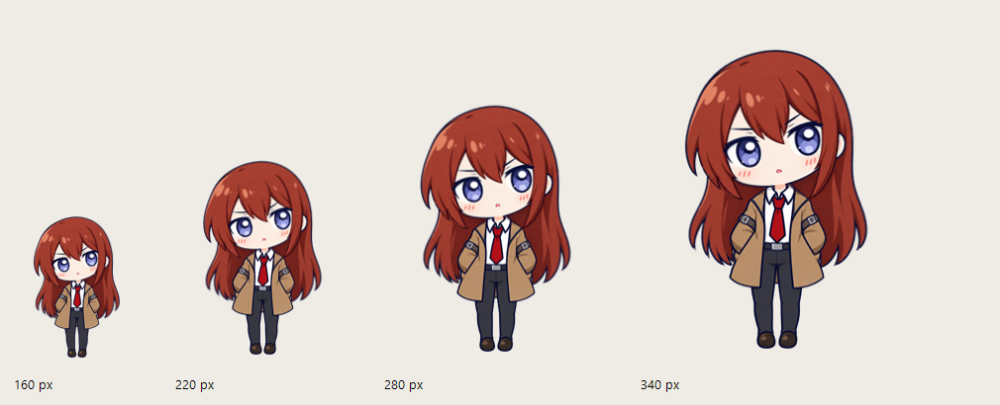

# 牧濑红莉栖桌宠 · 第一版

独立的 Windows 桌面小挂件。当前八张透明立绘根据用户提供的角色截图制作，属于**待确认的原型美术**，不冒充最终定稿；生成记录见 `assets/concepts/`。程序不连接网络，也没有账号、语音或大模型功能。



[查看动作预览](docs/media/motion-preview.gif) · [验收记录](docs/TESTING.md) · [GitHub 提交说明](docs/REPOSITORY.md)

## 目录结构

```text
src/                 程序源码
assets/              运行素材、可编辑底稿及生成记录
tests/               测试源码、后台验收脚本和预览编码脚本
tools/               分层素材处理工具
docs/                验收记录、仓库说明和精选预览
build.ps1            本地构建入口
package.ps1          手动打包入口
dialogues.json       本地台词
App.config           .NET 配置
app.manifest         Windows 程序清单
dist/                本地运行目录（Git 忽略）
test-artifacts/       测试输出和原始截图（Git 忽略）
releases/            压缩包及旧版归档（Git 忽略）
```

## 运行

适用环境：Windows 10/11，.NET Framework 4.8。从 GitHub 下载源码后先运行下方构建命令；当前本机开发版可直接双击 `dist/MakiseDesktopPet.exe`。旧 ZIP 已归档到 `releases/previous/`，未同步后续改动。请保留 exe 旁边的 `dialogues.json`、`assets/sprites` 和 `assets/layers/idle-v1`。默认不会设置开机启动，也不需要管理员权限。

首次启动出现在主屏幕右下角，角色高度 220 像素。每次普通左键点击依次显示嘟嘴、半眯眼、单眼眨眼，再从嘟嘴循环，并显示约 5 秒的气泡；被戳表情约 650 毫秒后恢复待机。按住角色移动可拖到新位置。拖动超过 6 像素才算拖拽，松开后显示拖动台词，不触发点击台词，也不推进表情循环。3 分钟没有和桌宠互动会睡觉，点击或拖动会唤醒；睡醒时的第一次点击仍显示唤醒表情，不推进被戳表情循环。只统计桌宠自身的鼠标操作。

1. 右键角色：换一句话、调整大小（160/220/280/340 像素）、“窗口层级 → 置顶 / 置底”、隐藏到托盘、退出。置顶时显示在普通窗口前；置底时位于普通窗口后，回到桌面可再次看到和点击角色。
2. 托盘：右键选择显示/隐藏或退出；双击托盘图标也能恢复角色。
3. 1.8 秒内点击 4 次触发一次特别吐槽，20 秒冷却。当前台词不会连续重复同一句。

隐藏后程序仍在托盘运行；选择“退出”才会结束进程。程序只在桌面上显示角色和小气泡，没有普通任务栏窗口。气泡自身不接收鼠标点击。

## 从源码构建和打包

先从托盘退出正在运行的桌宠，再在项目目录打开 PowerShell：

```powershell
.\build.ps1
.\dist\MakiseDesktopPet.exe
```

当前机器没有 .NET SDK，构建脚本使用 Windows 自带的 .NET Framework C# 编译器和系统图形库。构建脚本复制八张状态图、七张待机图层和图层清单到 dist，不会重新生成或覆盖源素材，也不会复制补画稿及预览。制作可解压运行的压缩包：

```powershell
.\package.ps1
```

打包输出到 `releases/`：`MakiseDesktopPet-Windows.zip`（可运行程序）和 `MakiseDesktopPet-Source.zip`（源码、测试、文档、构建脚本与全部原型素材）。源码包解压后先构建；运行包解压后保留目录结构，运行其中的 exe。配置保存在 `%LOCALAPPDATA%\MakiseDesktopPet\settings.json`，会保存位置、高度和窗口层级选择；显示器变化时角色会回到可见工作区。打包和运行都不需要联网。

## 换成最终角色素材

请提供下列 **8 张透明背景 RGBA PNG**，放在 `assets/sprites/` 中，文件名必须完全一致：

| 文件 | 真正的状态图切换 |
| --- | --- |
| `idle.png` | 原待机底稿，保留用于尺寸和布局参考；实际待机使用分层素材 |
| `blink.png` | 原闭眼底稿，保留用于素材参考；实际眨眼使用三档眼睛图层 |
| `poke.png` | 第一次点击：嘟嘴 |
| `poke-skeptical.png` | 第二次点击：半眯眼斜视 |
| `poke-wink.png` | 第三次点击：单眼眨眼 |
| `drag.png` | 向右拖时使用原图（双腿朝左）；向左拖时水平镜像 |
| `sleep.png` | 打瞌睡 |
| `wake.png` | 刚醒来 |

当前原型使用 1122×1402 像素画布。正式图片也可以使用别的尺寸，但八张画布必须完全一致，人物在相同位置、大小接近，双脚尽量对齐；建议四周只留少量透明边，减少透明窗口的占位。替换素材后重新运行 `.\build.ps1`，或直接替换已解压目录中的同名 PNG。请只使用你有权使用的角色素材。

当前原型的三张被戳图比 `idle.png` 略亮。程序只在识别到这些原型图的原始文件时，于内存中分别校准暗部亮度；不会修改 PNG 文件。换成其他同名 PNG 后，对应校准自动失效，正式素材应由美术统一色阶。

当前已接入第 3 步分层待机动画，使用 `assets/layers/idle-v1`：

- 窗口位置和身体底部 12%（包括鞋子）保持不动。身体呼吸周期 4.2 秒，220 像素时身体层顶部压缩量最大约 1.5 像素，随尺寸调整，最大 2 像素。头部随颈部实际位移衔接，并独立以约 6.2 秒周期、±0.38 度轻晃。
- 左右后发分别延迟约 220/340 毫秒跟随头部，并带很小的独立摆动（最大约 ±0.55/0.52 度）。重新进入待机时，摆动幅度用 240 毫秒逐渐恢复。
- 眨眼间隔随机 2.8～6.8 秒，依次经过半闭 45 毫秒、闭眼 110～170 毫秒、半闭 50 毫秒，再睁眼。约 10% 概率追加一次短间隔眨眼。眼睛与头部在缩放前合成，避免位置漂移。
- 普通点击保留三张表情循环，增加 250 毫秒的轻微收缩、回弹和恢复。连续点击不会叠加回弹幅度；拖动开始时取消回弹。
- 动作按实际经过时间计算；定时器请求间隔 16 毫秒，分层待机渲染最多每 16 毫秒更新一次，表情变化可即时更新；复用绘图缓冲。此设置不保证稳定 60 帧。

待机呼吸、头部和后发晃动使用分层图加程序变换，眨眼是三档眼睛图层切换。三种被戳表情、拖动、睡觉和唤醒仍使用原独立状态图，点击保留第 1 步的平面回弹。因此这些状态之间仍可能有轮廓差异；渐进垂头和拖动松手缓动尚未实现。第一版没有 Live2D、行走、攀爬和屏幕识别。

拖动时双腿朝移动方向的反方向：向左拖时朝右，向右拖时朝左。中途反向移动约 4 像素后切换，减少轻微抖动造成的来回翻转；纯上下移动沿用当前朝向。这里使用整张拖动图的水平镜像，头发与衣服也会翻转，不是单独的腿部动画；松开后恢复普通待机图。

台词保存在 `dialogues.json`，按 `click`、`rapid`、`wake`、`drag` 四类编辑。每类至少保留两句非空台词；当前共有 21 句。修改后重新启动程序即可读取新台词。

### 待机分层素材（第 2/3 步）

七张图层、三档眼睛合成预览、遮挡检查、转轴说明和补画记录在 [assets/layers/idle-v1](assets/layers/idle-v1/README.md)。第 3 步已接入运行程序。更换待机角色时需同时替换这七张同画布图层，并维护 layers.json 的文件名、画布尺寸和转轴；只换 idle.png 不会改变分层待机外观。

## 实测与限制

在 Windows 11、150% 显示缩放和 .NET Framework 4.8 环境开发。早期版本做过透明窗口、实际点击/拖动、焦点、托盘和菜单检查；分层版本第 3 步另做了透明窗口回归。第 4 步为了不打扰用户使用电脑，采用后台渲染和事件检查：四种尺寸、点击表情循环、方向切换、真实三分钟入睡、气泡期限、设置及边缘布局通过；本轮没有重测真实鼠标和系统托盘操作。逐轮证据及限制见 [TESTING.md](docs/TESTING.md)。

第 4 步的 [动作节选](docs/media/motion-preview.gif) 和 [四尺寸对照](docs/media/four-sizes.png) 随源码保存，都是测试输出，不是替换素材；动画来自程序渲染帧，不是桌面录屏。完整时间线 `test-artifacts/step4/full-timeline.gif` 和原始 PNG `test-artifacts/step4/frames/` 仅本机保留，不提交 Git；可运行 `tests/run-step4.ps1`，再使用安装有 Pillow 的 Python 运行 `tests/encode-step4.py` 重新生成。日常运行无需这些测试文件。当前已停在验收阶段，没有重新打包。

只有一台显示器，拔插显示器和跨屏操作尚未实测；也尚未在另一台 Windows 机器上运行。长时间稳定性及分层动作的主观手感仍需实际使用确认。当前角色图是待确认的原型美术。
