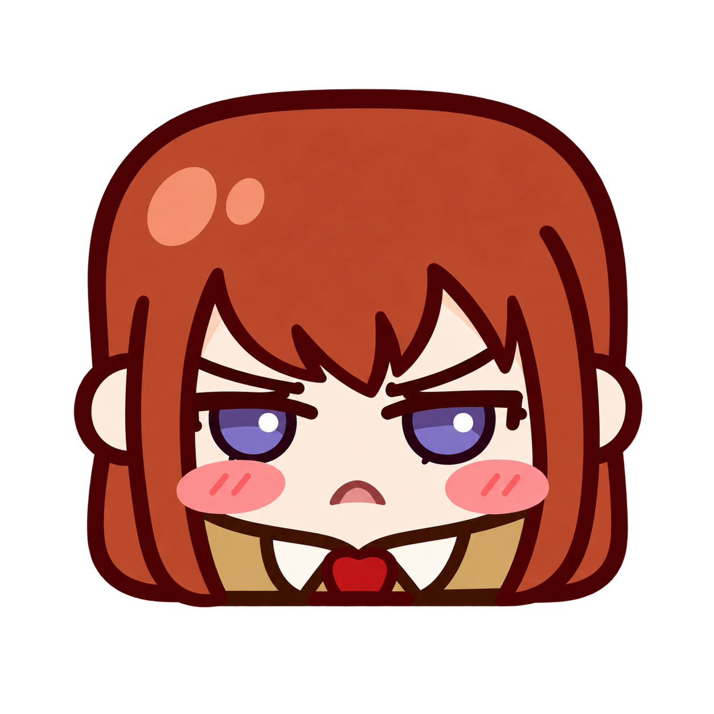
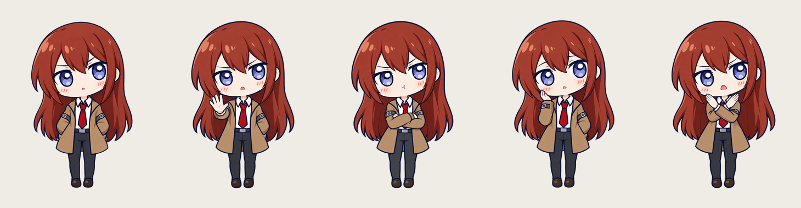
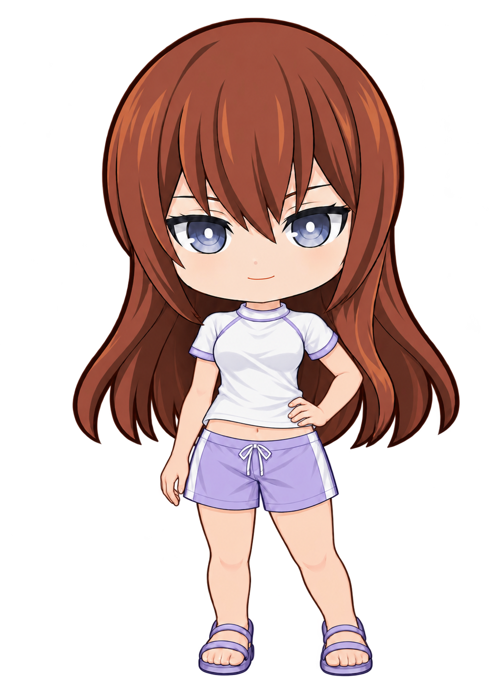
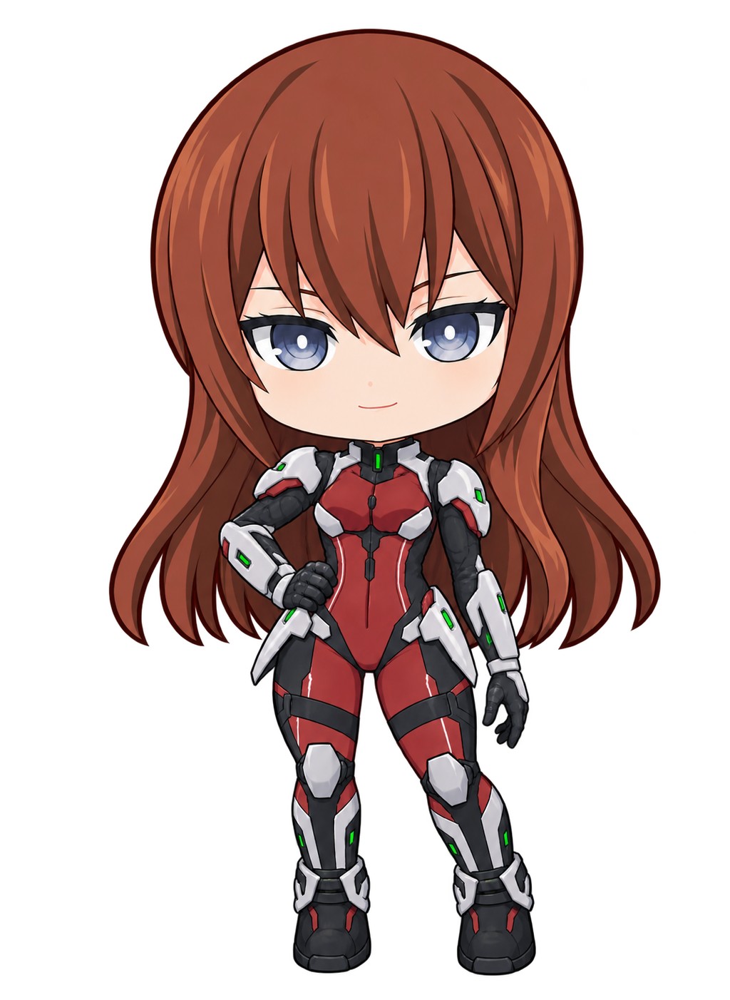
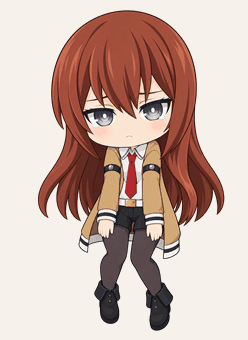
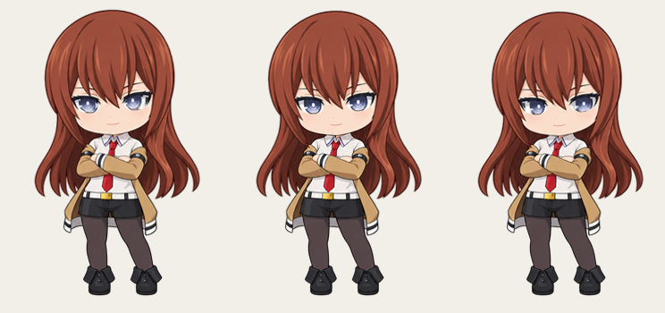
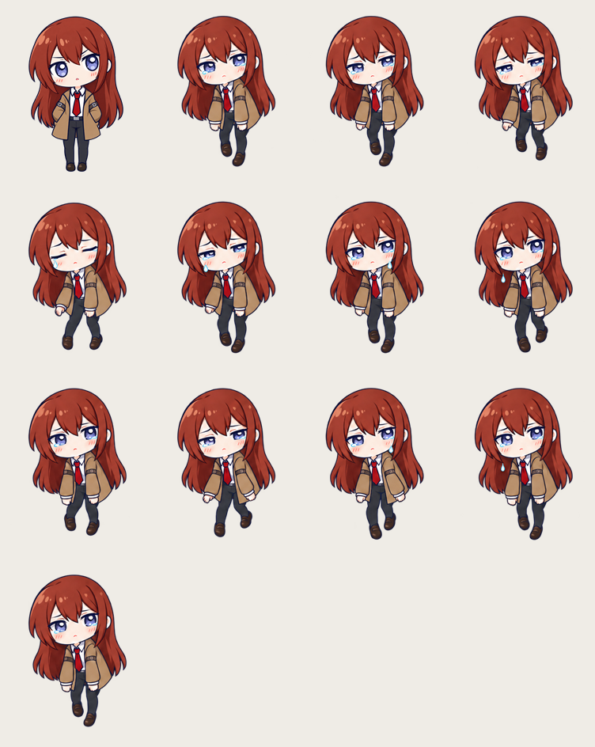

# Windows 桌宠 · 牧濑红莉栖



透明背景、无边框的 Windows 桌面小挂件：会眨眼、呼吸、回应点击，也会在安静时打瞌睡；原版与七套服饰均能用眼睛追随鼠标。基础互动无需联网、登录、管理员权限或付费 API；可选的本地聊天在首次下载模型后也能离线使用。

**当前版本：v3.1.2。** 普通用户请下载 Windows 运行包，完整解压后双击 `MakiseDesktopPet.exe`，无需编译。角色改用统一的 2D 造型，并可从原版切换到七套服饰；选择会保存在本机，重启后继续使用。

[下载 Windows 运行包](https://github.com/zhangchuancheng/Windows-Desktop-Pet-Kurisu/releases/download/v3.1.2/MakiseDesktopPet-Windows.zip) · [发布页面与源码包](https://github.com/zhangchuancheng/Windows-Desktop-Pet-Kurisu/releases/tag/v3.1.2)

请保留程序旁的 `assets/`、`dialogues.json`、`chat-persona.json` 和配置文件，不要只移动 EXE。运行包内的“使用说明.txt”包含启动、操作、聊天设置、更新和常见问题。

更新时先从托盘退出旧版，再把新版完整解压到新文件夹，运行其中的 EXE。原有设置和聊天偏好会继续沿用；桌面快捷方式请改为指向新版。源码包用于开发，普通使用请选择 **Windows 运行包**。

## v3.1.2 更新：交互修复与缩放优化

- 保留等待聊天回复期间编辑的新草稿，避免回复到达时误清空输入。
- 拖拽被系统中断、鼠标捕获丢失或隐藏角色后正确恢复；调整大小的滑条中断时也会保存当前选择。
- 设置文件被占用或无写入权限时，当前设置继续生效并提示保存失败，后续调整会重试；退出时仍完成资源清理。
- 缓存服饰眨眼原图，减少调整大小时的卡顿。本机实验服、战斗装单次缩放由约 0.9–1.1 秒降至约 0.17–0.25 秒；不同电脑耗时会不同，仍存在短暂同步处理时间。
- 设置菜单自动适配屏幕工作区，避免小屏幕上底部选项不可见，同时保留用户选择的缩放比例。

本轮 14 项回归通过；七套服饰、三种尺寸、三种眼睛状态共 63 组画面与修复前逐像素一致。完整记录见 [更新说明](CHANGELOG.md) 和 [验收记录](docs/TESTING.md)。

## 本地聊天（可选）

右键角色或托盘图标，选择“聊两句”，即可打开只用于输入的紧凑面板。回车发送，Shift+回车换行，Esc 关闭；模型回复由角色气泡显示。只在你主动打开输入面板时接收键盘输入；普通点击仍播放 `dialogues.json` 中的本地预设台词。

首次聊天前，请先完成以下两步（约 2.5 GB 模型下载，需要联网；实际下载量以 Ollama 显示为准）：

1. 安装并启动 [Ollama for Windows](https://ollama.com/download/windows)。
2. 双击运行包中的 `Install-Chat-Model.cmd`，等待模型下载完成。也可以打开 PowerShell，手动运行 `ollama pull qwen3:4b-instruct`。然后启动桌宠并选择“聊两句”。

**模型和 Ollama 不包含在 Windows 运行包中。** `Install-Chat-Model.cmd` 及 `setup-chat.ps1` 只是调用本机 Ollama 下载模型；模型由 Ollama 保存在本机用户目录。下载完成后，桌宠仅连接本机 `127.0.0.1:11434`，聊天不需要云端账号、付费 API 或持续联网。Ollama 未运行时，输入面板会提示启动它；缺少模型时会提示运行上述 `ollama pull` 命令。未配置聊天时，其余桌宠功能仍可使用。首次加载模型可能较慢。

桌宠右键设置及托盘菜单中的“聊天偏好”可设置称呼、回复长短、感兴趣和希望避开的话题。偏好只保存在 `%LOCALAPPDATA%\MakiseDesktopPet\chat-preferences.json`；保存偏好后会清空本次对话。默认角色口吻提炼自作者的 [SillyTavern v1.4 角色卡](https://github.com/zhangchuancheng/SillyTavern-Character-Card/blob/main/makise_kurisu_ccv2_zh.json)，对应程序旁的 `chat-persona.json`；它只保留适合桌面短聊的性格与边界，修改后重启程序生效。

本次运行中最多保留最近 12 轮对话，并尝试记住少量更早的用户明确事实；退出后不保存聊天记录。长消息仍可能挤占上下文，小模型也可能答非所问或编造细节。对一部分未经证实的场景描述，程序会重试一次，必要时使用本地短句回退。



从左到右：原版 2D 造型的待机、抬手挡戳、抱臂嘟脸、轻捂脸颊、连续点击叉手。三张普通点击图与待机的脸部比例、身体站位和鞋底位置相近；其他动作的头发和脸部色阶也按待机图校准。浅色底仅用于展示透明边缘。

## v3.1.1 更新：服饰动作配色校准

七套服饰共 77 张动作图完成离线校色：发色和肤色向原版待机统一，衣物向各套自己的待机配色统一，减小换装及动作切换时的色差。保留阴影层次、原有动作和透明边缘，继续支持局部眨眼、滴泪与鼠标追视。详见 [配色校准说明](docs/OUTFIT-COLORS.md)。

## v3.1.0 更新：所有服饰的追视、泪滴与眨眼

原版和七套服饰均使用各自的 `drag.png` 静态悬垂姿态，身体与头发保持静止，双眼泪滴交错落下，每滴约 0.54 秒并渐隐。拖拽约 1.2 秒后首次眨眼，之后每隔约 2.8 秒眨眼，每轮有 30% 概率连续眨两次。各套服饰独立校准眼部位置与泪滴起点，眨眼只改变完整眼部区域；松开后回到待机，不误触点击。原版旧身体摆动代码、底稿和配置保留，恢复方法见 [素材说明](docs/ASSETS.md#原版拖拽的停用与恢复)。这些改动已包含在 v3.1.0 运行包中；下方动态拖拽 GIF 是历史版本演示。

七套服饰现已接入平滑鼠标追视，分别校准睁眼与半闭眼的眼眶范围。半闭眼时减小转动幅度，闭眼时暂停眼球移动；继续使用局部眨眼，不切换旧全身眨眼图。

同时修复桌宠右键设置中偶发换装失败：打开菜单及服装列表时正确处理前台焦点，避免选择前菜单被提前关闭。托盘换装入口继续保留。

## v3.0.0 更新：2D 造型与七套换装

v3.1.0 已修复七套服饰待机时的眨眼抽动：统一保留待机身体，只改变眼部，呼吸动画持续运行。旧全身眨眼图仍保留作参考，检查结果见 [待机眨眼修复记录](docs/IDLE-BLINK-FIX.md)。下列内容为 v3.0.0 发布时记录。

七套新增皮肤的待机样式（从左到右与服装菜单顺序一致）：

<table>
  <tr>
    <td align="center" width="14%"></td>
    <td align="center" width="14%"></td>
    <td align="center" width="14%"></td>
    <td align="center" width="14%"></td>
    <td align="center" width="14%"></td>
    <td align="center" width="14%"></td>
    <td align="center" width="14%"></td>
  </tr>
  <tr>
    <td align="center">实验服</td>
    <td align="center">女仆装</td>
    <td align="center">浴衣</td>
    <td align="center">圣诞装</td>
    <td align="center">红礼服</td>
    <td align="center">运动泳装</td>
    <td align="center">战斗装</td>
  </tr>
</table>

- 待机、三张普通点击图、连点叉手、睡眠、唤醒和拖拽底稿都已换成统一的平面 2D 造型，人物比例与鞋底位置对齐。
- 原版待机从单张图连续计算轻微呼吸和头发响应，眨眼仅替换眼部；追视保留。原版拖拽由新悬垂姿态连续计算四肢和发梢摆动，眼角泪光与程序滴落泪珠保留。
- 睡醒显示单张 `wake.png` 姿态图，约 850 毫秒后回到待机；连续 3 分钟没有与桌宠互动后自动入睡，移动鼠标不会重置计时。
- 右键角色打开设置并选择“切换服装”，或从托盘右键菜单进入；可选原版、实验服、女仆装、浴衣、圣诞装、红礼服、运动泳装和战斗装。切换立即生效，重启后保留；选“原版”即可切回。
- 红礼服使用手部修订版，挡手动作的横胸手臂已经重画。修正了战斗装状态下服装列表无反应的问题，并提供托盘换装入口。
- 七套换装有各自的点击、连点、睡眠、唤醒和拖拽姿态图。换装暂不使用原版的局部眼睛追视和动态拖拽形变；眨眼使用各套独立图片，部分装扮会出现轮廓跳动。原版保留完整追视与动态拖拽。



原版造型的预览由实际拖拽渲染器按模拟鼠标轨迹输出 80 帧后编码，时长 2.56 秒，不是真实鼠标录屏。人物底稿是一张透明悬垂姿态；左右晃动、回正和泪滴由程序实时绘制。

## v2.4.0 更新

- 增加可选的本地聊天：紧凑输入面板、人物气泡回复、桌宠设置内的聊天偏好；首次使用需自行安装 Ollama 并下载模型，运行包提供下载引导脚本。
- 会话在内存中保留最近最多 12 轮，并保留少量较早的明确用户事实；关闭程序或保存偏好后清空。
- 基础动作、普通点击台词和托盘控制不依赖模型。

<details>
<summary>查看 v2.3.0 的动作与界面更新</summary>

- **连续拖拽动作**：使用一张完整的悬垂姿态图，依据鼠标移动速度连续调整双腿、双手和发梢；停下后自然回正。拖拽图已与待机、点击图对齐大小和落点，眼角泪光与滴落泪珠保留。
- **控制界面**：右键面板改为米白圆角设计；角色大小用 100–500 像素滑条调整，面板自身另可在 80%–150% 缩放；置顶和置底直接切换。
- **追视修正**：眼睛对靠近角色的鼠标更敏感；眼眶内的眼球画面转向时，眼白露出量和虹膜宽度会一起变化，头部稍慢跟随。极端方向下眉毛与侧发保持正常轮廓，眨眼仍能衔接；鼠标移动不计入互动。
- 保留三张普通点击表情、叉手连击、动态 ZZZ、近正方形图标和 60 条本地台词。

</details>



上图是原版造型渲染的三个静态方向，浅色底仅用于展示透明边缘；实际过渡由程序平滑计算。v3.1.0 的七套换装也已启用局部眼睛追视，并使用各自校准的眼部配置。

<details>
<summary>查看旧版十二帧拖拽记录</summary>



第一格为待机参考，随后按行展示旧版十二帧动作。这是历史程序渲染图，不代表当前拖拽画面。

旧版往返播放和泪滴的[预览记录](docs/media/drag-motion-preview.gif)保留用于对照；历史版本的原版造型使用 `drag-base.png` 生成连续形变；v3.1.0 使用静态身体、独立泪滴与眨眼。

</details>

完整记录见 [CHANGELOG.md](CHANGELOG.md)。保留的功能包括动态 ZZZ 睡眠、60 条原创中文台词、置顶/置底、托盘与设置保存；当前本地源码的待机已改为单图连续微形变。

## 从源码构建

环境：**Windows 10/11、.NET Framework 4.8、Windows PowerShell**。无需安装 .NET SDK 或 Python。

下载源码并解压，在项目文件夹打开 PowerShell，执行：

```powershell
powershell -NoProfile -ExecutionPolicy Bypass -File .\build.ps1
.\dist\MakiseDesktopPet.exe
```

重新构建前请从托盘退出正在运行的桌宠。构建使用系统自带的 .NET Framework C# 编译器，输出到 `dist/`；之后可以直接双击其中的 `MakiseDesktopPet.exe`。

请保留 EXE 旁的 `MakiseDesktopPet.exe.config`、`dialogues.json`、`chat-persona.json` 和整个 `assets/` 文件夹（包括 sprites、icons）。默认不会设置开机启动。

## 操作

| 操作 | 效果 |
| --- | --- |
| 移动鼠标 | 所有服饰清醒待机时，眼珠先看向指针，头部和后发稍慢地轻微跟随；不算作互动，不推迟睡觉 |
| 普通左键点击 | 三种表情依次循环，伴随轻微回弹和约 5 秒的中文气泡 |
| 1.8 秒内点击 4 次 | 进入叉手姿态；继续点击保持，停点约 1.2 秒后恢复 |
| 按住并移动 | 超过 6 像素开始拖拽；松开保存位置，不误触点击 |
| 3 分钟不与桌宠互动 | 自动睡觉，缓慢呼吸并出现飘动的 ZZZ；点击或拖动唤醒 |
| 右键角色 | 换一句话、切换服装、滑动角色大小、调整界面大小、切换置顶/置底、隐藏、退出 |
| 右键角色 → 设置中的“切换服装” | 在原版、实验服、女仆装、浴衣、圣诞装、红礼服、运动泳装、战斗装之间选择；选择后自动保存，重启后继续使用 |
| 托盘图标右键 → “切换服装” | 第二个换装入口；无论当前穿哪套，都能切回“原版”或选择其他服装，角色被遮住时也能使用 |
| 托盘右键 / 双击 | 显示、隐藏、切换服装、退出 / 恢复显示 |
| 右键角色或托盘中的“聊两句” | 打开本地聊天输入面板；回复显示在人物气泡中，需要 Ollama 和模型 |
| 右键角色或托盘中的“聊天偏好” | 设置称呼、回复长短与话题偏好，保存后开始新会话 |

- 初始高度 220 像素；右键菜单中的“角色大小”滑条从左到右可设为 100–500 像素，松开后保存。首次启动位于主屏幕右下角。
- “界面大小”用减号和加号以 10% 为步长调整右键面板，范围 80%–150%。默认 100% 相当于旧版 120% 的实际尺寸；它不改变角色大小，调整后立即保存。
- 窗口不抢键盘焦点；只统计桌宠自身互动，不监控其他程序的键盘输入。
- 鼠标追视只读取当前指针坐标，不安装全局输入钩子；点击、拖动和睡眠时自然回到正视方向。
- 连续点击的特别吐槽有独立 20 秒冷却，保持叉手时不反复刷新气泡。
- 隐藏仍会在托盘运行，选择“退出”才会结束进程。置底表示位于普通窗口后方。
- 位置、角色大小、界面大小、窗口层级和服装选择保存在 `%LOCALAPPDATA%\MakiseDesktopPet\settings.json`；显示区域变化时会将角色移回可见区域。

立即预览睡眠：先退出桌宠，再运行 `.\dist\MakiseDesktopPet.exe --preview-sleep`。

## 素材与开发

素材与逻辑分离。角色图根据用户提供的参考制作，属于 AI 辅助制作的项目原型素材；生成过程保存在 `assets/concepts/`，不是官方美术或官方授权声明。

| 路径 | 内容 |
| --- | --- |
| `src/` | C# / Windows Forms 源码 |
| `assets/sprites/` | 原版 2D 状态图、三档眼睛、单张唤醒图、单张拖拽底稿与动画坐标配置 |
| `assets/concepts/outfit-actions-2026-10-19/` | 七套换装的动作图；构建时复制各套顶层 PNG 到运行包的 `assets/outfits/` |
| `assets/concepts/` | AI 辅助制作的源图和画风预览，不由程序加载 |
| `assets/icons/` | 图标母版、多尺寸 ICO 与说明 |
| `dialogues.json` | 60 条本地原创台词 |
| `chat-persona.json` | 本地聊天用的精简角色设定；与个人偏好分开 |
| `tests/`、`tools/` | 测试及素材处理工具 |
| `docs/` | 替换说明、测试记录和精选预览 |
| `dist/`、`test-artifacts/`、`releases/` | 本地构建、测试、压缩包，均不提交 Git |

[素材、动画与台词替换](docs/ASSETS.md) · [测试运行方法](tests/README.md) · [仓库说明](docs/REPOSITORY.md)

当前采用待机单图微形变、点击状态图切换和单张唤醒图；所有服饰拖拽均使用各自的静态身体并叠加泪滴与局部眨眼。不使用 Live2D，也没有行走、攀爬、桌面识别、云端聊天或语音。不同状态仍可能有细微轮廓差异，唤醒结束与拖动松手切回待机仍是即时切换。

## 验证范围

开发与测试环境为 Windows 11、150% 显示缩放、.NET Framework 4.8。后台测试覆盖四种尺寸、透明边缘、眨眼、点击与连击、拖拽状态、睡眠呼吸和 ZZZ；自然三分钟入睡及焦点、托盘的历史实测记录见 [TESTING.md](docs/TESTING.md)。

v2.4.0 的历史检查包括九项后台回归、两项本地聊天专项检查，以及 ZIP 解压、源码独立构建和 Windows 包启动。v3.0.0 增加新画风与七套服装切换；当前素材不再使用旧的运行时配色校准。具体检查范围与仍需目视判断的动作问题见 [验收记录](docs/TESTING.md) 和 [换装素材说明](docs/ASSETS.md)。

后台验证不代替鼠标手感、系统托盘的前台验收；多显示器拔插、另一台 Windows 机器和长期稳定性仍待验证。较早的 [动作节选](docs/media/motion-preview.gif) 与 [尺寸对照](docs/media/four-sizes.png) 属于历史预览，不代表当前全部素材与动作。

原版连续拖拽渲染已在 100/160/220/280/340/355/500 像素下检查图像对齐、双向拖动、停下回正、透明边缘和颜色；实际鼠标拖动的手感仍以本机桌宠为准。

## 手动打包

自行制作 ZIP 时，在退出桌宠后执行：

```powershell
powershell -NoProfile -ExecutionPolicy Bypass -File .\package.ps1
```

输出位于 `releases/`，包含运行包和源码包；无需联网。素材替换或代码修改后，应重新构建对应运行程序。
