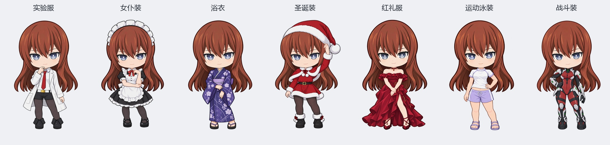

# v3.2.0 七套服饰专属待机

以各套已有的 2D 立绘为编辑底稿，使用内置图像生成工具重画待机手臂与手部。候选图经用户确认后替换；未改变原版待机。人物、服装和配色沿用既有设计，图片是非官方同人项目的 AI 辅助制作素材。

| 服装目录 | 已选待机动作 |
| --- | --- |
| `lab-coat` | 一手扶颌思考，另一手自然垂落 |
| `maid` | 一手扶另一侧手肘，另一手抬至领口附近（候选 B） |
| `yukata` | 一手轻拢另一侧袖口，另一只手从袖边自然露出 |
| `christmas-v2` | 一手轻扶帽檐，另一手自然垂落 |
| `red-dress-handfix` | 双手在身前轻轻交叠（候选 C） |
| `beachwear-v2` | 单手叉腰，另一手自然垂落 |
| `battle-suit` | 一只戴手套的手在腰侧握拳，另一手放松垂落 |

生成约束：保持原有脸型、眼睛、发型、头身比例、服装细节、画风和完整人物构图；重点重画合理的肘腕连接、手指与袖口遮挡；不增加道具、背景或文字。完整候选和生成提示词保存在本机制作记录，运行包只包含确认后的素材。

确认后的 1072 × 1467 透明候选图通过预乘 alpha 的 Lanczos 缩放规范为 1024 × 1402 RGBA，未额外拼接手部或改写人物。每套只替换顶层 `idle.png`，构建后同步到 `assets/outfits/<目录>/idle.png`。

检查新旧图的眼眶边界后，保留 `idle-blink.json` 与 `idle-motion.json`。换装待机由当前底图局部绘制眨眼，不读取旧全身 `blink-half.png`、`blink.png` 作为身体，因此眨眼时仍保持新姿势。呼吸和追视由现有程序继续计算。

原版立绘及七套的点击、连点、拖拽、睡眠、唤醒均未修改。唤醒仍显示原单张过渡图，再回到各自的新待机姿势；本次没有新增动作插帧。

验证包括 100/355/500 像素下局部眨眼不改变身体、九方向追视不改变透明轮廓、睁眼与视线回中精确恢复，以及所有服装的加载、持久化、托盘切换、原版回退和缺失素材回滚。已查看七套新待机的眨眼与追视渲染图；后台检查不替代其他电脑的实机观感验收。
